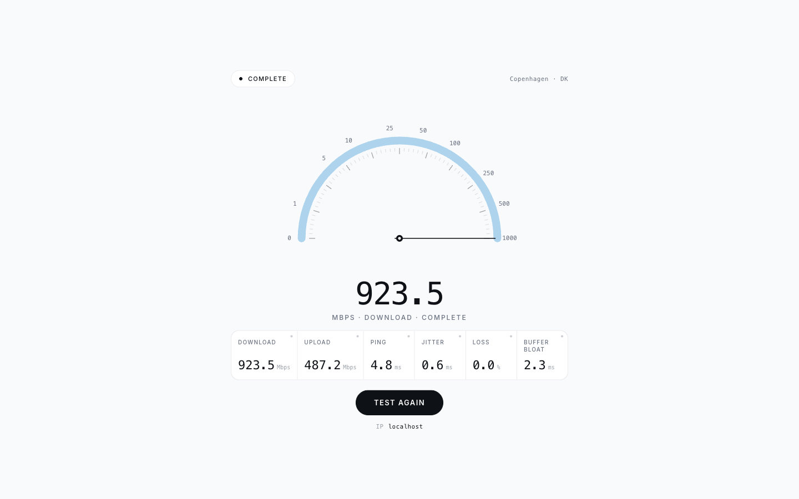

# infobits-speedtest

A simple, self-hosted speedtest written in Go. Measures ping, jitter, packet
loss, download, and upload throughput from any modern browser. Ships as a
single static binary or container, no database, no third-party telemetry.



## Run it (Docker)

A multi-arch image (`linux/amd64`, `linux/arm64`) is published to GitHub
Container Registry on every push to `master` and on every release tag.

```sh
docker run --rm -p 8080:8080 \
  -e SERVER_LOCATION="Home lab" \
  ghcr.io/infobits-io/infobits-speedtest:latest
```

Open <http://localhost:8080>.

For production, pin to a release tag and run detached:

```sh
docker run -d --restart unless-stopped -p 8080:8080 \
  --name speedtest \
  -e SERVER_LOCATION="Copenhagen · DK" \
  ghcr.io/infobits-io/infobits-speedtest:v1.0.0
```

Available tags: `latest`, `master`, `vX.Y.Z`, `X.Y`, `X`, and short commit
SHAs. See the [package page](https://github.com/infobits-io/infobits-speedtest/pkgs/container/infobits-speedtest)
for the full list.

## Run it (Docker Compose)

The `compose.yaml` in this repo builds locally. To use the pre-built GHCR
image instead, drop this into a new `compose.yaml`:

```yaml
services:
  speedtest:
    image: ghcr.io/infobits-io/infobits-speedtest:latest
    ports:
      - "8080:8080"
    environment:
      SERVER_LOCATION: "Home lab"
    restart: unless-stopped
    read_only: true
```

Then `docker compose up -d`.

## Run it (from source)

```sh
git clone https://github.com/infobits-io/infobits-speedtest.git
cd infobits-speedtest
make run                       # go run .  →  http://localhost:8080
```

Or build a static binary:

```sh
make build                     # produces ./speedtest
./speedtest
```

The web assets are embedded into the binary via `//go:embed web`, so the only
artifact you ship is the executable.

## Behind a reverse proxy

Terminate TLS at the proxy and forward to port 8080. **Disable response
buffering** — the throughput measurement uses chunked transfer, and any
buffering on the proxy side will skew the readings.

### Caddy

```caddy
speedtest.example.com {
    reverse_proxy localhost:8080 {
        flush_interval -1
    }
}
```

### nginx

```nginx
server {
    listen 443 ssl http2;
    server_name speedtest.example.com;
    # ... ssl_certificate / ssl_certificate_key ...

    location / {
        proxy_pass http://localhost:8080;
        proxy_http_version 1.1;
        proxy_buffering off;
        proxy_request_buffering off;
        proxy_set_header Host $host;
        proxy_set_header X-Forwarded-For $proxy_add_x_forwarded_for;
        proxy_set_header X-Real-IP $remote_addr;

        client_max_body_size 0;   # allow large upload-test bodies
    }
}
```

### Traefik

Make sure the router/service does not buffer responses; for Traefik v3 the
default is already streaming. Forward to the container's port `8080` and
preserve `X-Forwarded-For` so the UI can show the visitor's real IP.

## Configuration

All settings come from environment variables. None are required.

| Variable             | Default            | Description                                                                              |
| -------------------- | ------------------ | ---------------------------------------------------------------------------------------- |
| `PORT`               | `8080`             | TCP port to listen on.                                                                   |
| `SERVER_LOCATION`    | ``  | Location label shown in the UI header (e.g. `Copenhagen · DK`).                           |
| `TEST_DURATION_SEC`  | `10`               | Seconds spent on each of download and upload.                                            |
| `PARALLEL_STREAMS`   | `4`                | Concurrent HTTP streams per direction.                                                   |
| `MAX_DOWNLOAD_BYTES` | `4294967296`       | Per-request download cap in bytes (4 GiB).                                               |
| `MAX_UPLOAD_BYTES`   | `4294967296`       | Per-request upload cap in bytes (4 GiB).                                                 |
| `LOG_FORMAT`         | `text`             | `text` (key=value) or `json`.                                                            |
| `LOG_LEVEL`          | `info`             | `debug`, `info`, `warn`, or `error`.                                                     |

## Endpoints

| Path        | Method | Purpose                                    |
| ----------- | ------ | ------------------------------------------ |
| `/`         | GET    | Web UI.                                    |
| `/config`   | GET    | Test configuration (JSON).                 |
| `/whoami`   | GET    | Client IP (respects `X-Forwarded-For`).    |
| `/ping`     | GET    | Minimal response used for RTT measurement. |
| `/download` | GET    | Streams `?bytes=N` zero bytes.             |
| `/upload`   | POST   | Discards the request body, reports size.   |

## Privacy

- No third-party requests. Fonts use the visitor's system stack; nothing is
  loaded from Google Fonts or any CDN.
- No analytics, no cookies, no tracking.
- All measurements happen directly between the visitor's browser and your
  server. The browser does the math — server-side timing isn't trustworthy
  due to TCP and proxy buffering.

## Development

```sh
make help                      # list every Makefile target
make run                       # run locally on :8080
make check                     # fmt + lint + test
make docker                    # build the local Docker image
make up      / make down       # docker compose up (foreground) / stop
make up-d    / make logs       # detached / tail logs
```

Tests:

```sh
make test                      # go test -race ./...
make lint                      # golangci-lint run ./...
```
